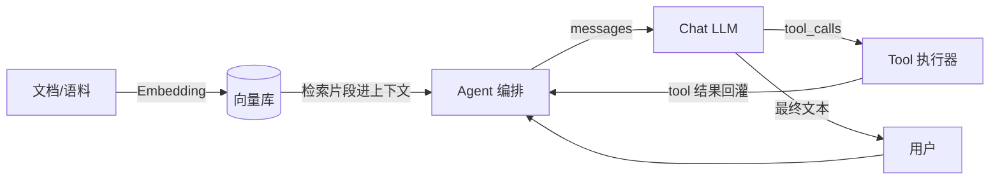

# 练习：AI 发展脉络与名词词典

> 对应文档：[`docs/09-ai-llm/01-ai-landscape-glossary.md`](../../docs/09-ai-llm/01-ai-landscape-glossary.md)  
> 状态：`已完成出题`  
> 建议用时：50～80 分钟（含热身）  
> Python：`≥ 3.11`

## 练习说明

1. 先读完文档「必掌握」再做题：LLM / Token / Context Window、预训练 / 微调 / 推理、Chat vs Completion。
2. 题目分档：**热身（建议先做） / 基础（必做） / 进阶（建议） / 挑战（可选）**。
3. 本章以**讲清名词 + 写伪请求 + 画关系图**为主，不必接真 API；代码题用纯 Python 即可。
4. 建议代码 / 笔记目录：

```text
playground/09-ai-llm/01-ai-landscape-glossary/
```

5. 先自己做完，再看文末「提示与参考答案」。文字题请写成可复查的完整段落/表格，不要只写「见文档」。

---

## 热身题（建议先做）

> 每题几分钟。用来把「计量 / 阶段 / 接口形态」三个坐标先摸一遍。

### W1. 一句话：LLM 在干什么？

**给定**：口语说法「模型在回答问题」。

**要求**：用**不超过两句**写出更精确的工程表述（提示：下一个 token / 条件生成）。

**验收**：

- [ ] 提到「根据上下文生成 / 续写」，而不是「查库返回真相」
- [ ] 没有把 ChatGPT 产品功能全部算进「模型本身」

---

### W2. Token 不是字数

**给定**：中文句子 `"你好，世界"`（仅作直觉素材，不必真调用 tokenizer）。

**要求**：写出 Token 与「字符数 / 词数」的区别，并说明为什么计费与截断常按 Token。

**验收**：

- [ ] 明确：Token ≠ 字符 ≠ 词
- [ ] 能说出至少 1 个工程后果（计费、窗口、截断）

---

### W3. Context Window 装什么？

**给定**：一次 Chat 请求。

**要求**：列出至少 4 类会占用 Context Window 的内容。

**验收**：清单里应能覆盖 system / 历史 messages / 检索片段 / 工具结果 中的多数。

---

### W4. 你站在哪一阶段？

**给定**：三阶段名——预训练 / 微调 / 推理。

**要求**：用一句话回答「Agent 开发者默认天天做的是哪一阶段？」，并举一个日常动作例子。

**验收**：答案是**推理（Inference）**；例子像「调 Chat API / 拼 messages」。

---

## 基础题（必做）

### B1. 名词解释：LLM / Token / Context Window

**给定**：文档 §3。

**要求**：用自己的话解释下列三个词，**各不超过 3 句**；每词至少带 1 个「错法」对照（例如：LLM ≠ 数据库）。

| 名词 | 你的解释（≤3 句） | 一个常见错法 |
|------|-------------------|--------------|
| LLM | | |
| Token | | |
| Context Window | | |

**验收（checklist）**：

- [ ] LLM：提到生成/续写或条件生成，且点出「不保证事实」
- [ ] Token：说明是模型读写的基本单位，并关联计费或窗口
- [ ] Context Window：说明是**单次请求可见容量**，不是产品「永久记忆」
- [ ] 三词各自有错法对照

可把表格保存为 `playground/09-ai-llm/01-ai-landscape-glossary/b1-glossary.md`。

---

### B2. 三阶段对照表：预训练 / 微调 / 推理

**给定**：文档 §4 总表。

**要求**：完成下表（可复制后填写）。列必须包含：**阶段、英文、做什么、输入大致是什么、输出大致是什么、你常不常做**。

| 阶段 | 英文 | 做什么 | 输入大致是什么 | 输出大致是什么 | 你常不常做 |
|------|------|--------|----------------|----------------|------------|
| 预训练 | | | | | |
| 微调 | | | | | |
| 推理 | | | | | |

额外写 3 行「想改变的行为 → 优先杠杆 → 阶段」（例如：要最新内部文档 → RAG → 推理）。

**验收**：

- [ ] 三行填满，且「推理」对应你天天调用的 API
- [ ] 「预训练」标明自己很少做
- [ ] 额外 3 行杠杆对照合理（Prompt/RAG/微调/预训练不混用）

---

### B3. Chat vs Completion：同一任务两段伪请求

**给定**：任务文案——「把 `hello` 翻译成中文」。

**要求**：

1. 写一段 **Completion** 风格伪请求（单段 `prompt` 续写）。
2. 写一段 **Chat** 风格伪请求（`messages` 列表，至少含 `system` + `user`）。
3. 用 2～4 句说明：为什么 Agent / 多轮工具环更偏向 Chat。

伪请求可用 Python dict / JSON / 伪代码，不必真发网。

**验收**：

```python
# 结构形状自检（把你的伪请求落成变量后跑）
completion_payload = {
    "model": "...",
    "prompt": "...",  # 单段字符串，含任务说明
}
chat_payload = {
    "model": "...",
    "messages": [
        {"role": "system", "content": "..."},
        {"role": "user", "content": "..."},
    ],
}
assert isinstance(completion_payload["prompt"], str)
assert all("role" in m and "content" in m for m in chat_payload["messages"])
assert chat_payload["messages"][0]["role"] == "system"
```

- [ ] 两段伪请求完成同一翻译任务
- [ ] 书面说明提到：角色边界 / 多轮历史 / tool 消息 中至少两点

---

### B4. 关系图：Embedding / RAG / Tool / Agent / Chat LLM

**给定**：文档 §6 总览。

**要求**：用手绘照片或 Markdown（mermaid / ASCII）画出五者关系，**箭头标明依赖或数据流**。图旁用条目写清：

1. Embedding 解决什么？
2. RAG 比「纯 Chat」多了哪一步？
3. Tool 与「模型直接生成答案」差在哪？
4. Agent 相对「单次 Chat」多了什么（循环 / 编排）？

建议 ASCII 骨架（可改）：

```text
[语料/文档] --embed--> [向量库]
                          |
                     retrieve
                          v
[User] --> [Agent 编排] --> [Chat LLM] --tool_calls--> [Tool 执行]
                ^                |
                |                +--> 生成最终回复
                +-- 工具结果 / 检索片段回灌 messages
```

**验收（checklist）**：

- [ ] 图中五者均出现
- [ ] 至少有一条「检索 → 进上下文 → 再生成」的 RAG 路径
- [ ] Tool 画在「模型提出、系统执行」一侧，而不是「模型内部魔法」
- [ ] 旁注四问均有回答

---

## 进阶题（建议）

### A1. 开闭源选型陈述

**给定**：两个场景——

1. **创业 MVP**：对外演示、要速度、团队小、先验证需求  
2. **强合规内网**：代码与文档不出域、可审计

**要求**：为每个场景写出：

- 倾向（闭源 API / 开源可自托管 / 混合）
- **恰好 3 条**理由（不要空话；可谈数据出域、运维、迭代、换模型、成本）
- 一条「适配层」工程提醒（业务勿写死某一家 SDK）

**验收**：

- [ ] MVP 倾向能自洽（通常偏闭源 API + 薄适配层）
- [ ] 内网倾向能自洽（通常偏私有化 / 内网推理）
- [ ] 每场景正好 3 条理由
- [ ] 提到适配层或统一 `chat()` / `complete()` 契约

---

### A2. 幻觉场景与缓解

**给定**：Agent 会调工具、会答内部制度、会报数字。

**要求**：

1. 举 **2 个**「幻觉会造成实质危害」的 Agent 场景（各 2～4 句：场景 → 胡说什么 → 后果）。
2. 给出 **至少 2 条**工程缓解（例如：RAG 强制引用、材料不足拒答、工具查权威源、结构化校验、人工确认高风险操作）。
3. 明确写一句：**缓解 ≠ 消灭幻觉**；提示分隔符若用到，只能标为**弱缓解**，不能单独当注入防护。

**验收（checklist）**：

- [ ] 两场景危害具体（钱 / 权限 / 合规 / 误操作等）
- [ ] 缓解可落地，不是「让模型认真一点」
- [ ] 出现「弱缓解」或等价表述，且未把分隔符写成银弹

---

## 挑战题（可选）

### C1. 术语闪卡 15 张

**给定**：文档 §9 名词速查（可补充本章其它必掌握词）。

**要求**：制作 **15 张**闪卡。每张格式固定：

```text
【正面】名词
【背面】一句话定义 + 一个你自己的例子
```

覆盖建议（可微调，但总数=15）：

LLM、Token、Context Window、Pretrain、Finetune、Inference、Chat、Completion、  
Embedding、RAG、Tool Calling、Agent、Hallucination、Temperature、System Prompt  
（也可用 Few-shot / Grounding / Guardrails / Tokenizer 替换其中若干）

保存为：

```text
playground/09-ai-llm/01-ai-landscape-glossary/flashcards-15.md
```

**验收**：

- [ ] 恰好 15 张，格式统一
- [ ] 背面「例子」是你自己的场景句，不是只抄标题
- [ ] 至少覆盖：Token、Context Window、Inference、RAG、Hallucination

---

## 验收标准（本章通过线）

- [ ] （建议）热身 W1～W4 先做完
- [ ] **通过线**：B1～B4 全部完成（表 / 伪请求 / 关系图可复查）
- [ ] 能口头讲清：Token 与窗口如何限制 Agent；自己默认活在推理层
- [ ] （建议）A1 或 A2 至少完成 1 题
- [ ] （可选）完成 C1 十五张闪卡

---

## 提示与参考答案（先做题再看）

> 每题先给**思路**，再给完整参考内容。答案不是唯一写法，能通过验收、坐标系不歪即可。

W1 思路 + 参考答案

**思路**：把「回答」还原成「条件生成」。

**参考答案**：LLM 根据已有上下文，逐 token 预测接下来最合理的续写；对齐之后看起来像在聊天或解题，但底层仍是生成，不是保证正确的查库。

---

W2 思路 + 参考答案

**思路**：计费与窗口按模型内部单位走。

**参考答案**：Token 是分词器切出来的子词/符号片段，中文一句话的 token 数往往 ≠ 字数；API 计费、Context 上限、截断策略通常以 Token 计量，所以工程上要建立「窗口预算」而不是只数字符。

---

W3 思路 + 参考答案

**参考答案（示例清单）**：

1. system 提示  
2. 多轮 user / assistant 历史  
3. RAG 检索到的文档片段  
4. tool 返回结果  
5. （可选）结构化 schema 说明、few-shot 示例  

---

W4 思路 + 参考答案

**参考答案**：默认做**推理（Inference）**——例如用 Python 拼 `messages` 后调用 Chat Completions，拿回 assistant 消息。

---

B1 思路 + 参考答案

**思路**：每个词钉死「是什么 / 不是什么」。

**参考答案（可直接对照自检）**：

| 名词 | 解释（示例） | 常见错法 |
|------|--------------|----------|
| LLM | 在大规模文本上训练的生成式模型；按上下文逐 token 续写。对齐后可对话、写代码、跟指令，但仍是条件生成。 | 当成精确数据库或搜索引擎 |
| Token | 模型读写的基本单位，由 tokenizer 把文本切成片段；长度、计费、截断多按它算。 | 当成「字数」或「英文单词数」 |
| Context Window | 单次请求里模型能「看见」的上下文容量上限（含提示、历史、检索、工具结果等）。 | 当成产品永久记忆 / 无限聊天记录 |

---

B2 思路 + 参考答案

**思路**：先填总表，再写「改行为用哪根杠杆」。

**参考答案：完整对照表**

| 阶段 | 英文 | 做什么 | 输入大致是什么 | 输出大致是什么 | 你常不常做 |
|------|------|--------|----------------|----------------|------------|
| 预训练 | Pretrain | 在海量数据上学语言与世界的统计规律 | 大规模通用语料 | 基座模型权重 | **很少**自己做 |
| 微调 | Finetune | 用领域/任务数据改行为或补知识 | 标注对话、领域文本、偏好数据等 | 适配后的权重（或 LoRA 等附件） | **有时** |
| 推理 | Inference | 用训练好的模型根据上下文生成 | Prompt / messages / 工具结果 | 文本、结构化输出、tool_calls | **天天做** |

**参考答案：行为 → 杠杆 → 阶段**

| 你想改变的行为 | 优先杠杆 | 阶段 |
|----------------|----------|------|
| 这次回答的格式/语气 | Prompt / messages | 推理 |
| 回答要依据最新内部文档 | RAG / 工具查库 | 推理 + 数据 |
| 稳定学会一种特殊决策风格 | 微调（需数据与评测） | 微调 |
| 从零创造一个基座模型 | 预训练 | 预训练（通常不是你） |

（验收要求 3 行即可；上表给 4 行供选用。）

---

B3 思路 + 参考答案

**思路**：同一任务，Completion 是单段续写；Chat 用角色消息，便于多轮与工具。

**参考答案：完整伪请求**

```python
# Completion 风格：单段 prompt，模型续写「译文」
completion_payload = {
    "model": "some-completion-model",
    "prompt": (
        "将英文翻译成简体中文。\n"
        "英文：hello\n"
        "中文："
    ),
    "max_tokens": 32,
    "temperature": 0,
}

# Chat 风格：messages 列表（现代 Agent 默认）
chat_payload = {
    "model": "gpt-x",
    "messages": [
        {
            "role": "system",
            "content": "你是翻译助手。只输出译文，不要解释。",
        },
        {
            "role": "user",
            "content": "把 hello 翻译成中文",
        },
    ],
    "temperature": 0,
}

assert isinstance(completion_payload["prompt"], str)
assert chat_payload["messages"][0]["role"] == "system"
assert chat_payload["messages"][1]["content"]
```

**为何 Agent 偏 Chat（示例表述）**：

1. `system` / `user` / `assistant` / `tool` 角色边界清晰，规则不易与用户话糊成一团。  
2. 多轮历史与工具结果可以按消息追加，适合「规划 → 行动 → 观察」循环。  
3. 流式 `tool_calls`、结构化消息与厂商 Chat API 生态对齐，Continuation 式裸字符串难扩展。

---

B4 思路 + 参考答案

**思路**：Embedding 服务检索；RAG = 检索 + 生成；Tool = 模型的手；Agent = 编排多步；Chat LLM 是生成核心。

**参考答案：关系图（Markdown / mermaid）**



**参考答案：ASCII 版**

```text
文档 --embed--> 向量库 --retrieve--> 片段
                                      |
用户 --> Agent 编排 ----messages----> Chat LLM ----> 最终回复
              ^                         |
              |                    tool_calls
              +----- tool 结果 <----- Tool 执行
```

**旁注四问（示例）**：

1. **Embedding**：把文本变成向量，使「语义相近」可计算，支撑检索。  
2. **RAG**：比纯 Chat 多了「先检索再把材料塞进上下文」；知识可更新、可追溯。  
3. **Tool**：模型提出结构化调用，由**你的系统**执行（查库/调 API）；真相来自外部系统，不是模型瞎编。  
4. **Agent**：在单次 Chat 之上增加规划、工具环、停止条件与状态编排，可多步完成任务。

---

A1 思路 + 参考答案

**思路**：按「数据是否出域 / 要不要自运维 / 速度」选型，并预留换模型能力。

**参考答案**

### 场景 1：创业 MVP

- **倾向**：闭源 API + 薄适配层（必要时以后再混开源）。  
- **理由 1**：上线快，少买 GPU、少养推理运维，先验证需求。  
- **理由 2**：生态与工具链成熟（SDK、可观测、结构化输出等），迭代速度优先。  
- **理由 3**：用环境变量 / 适配层切换模型；核心敏感数据尽量少上传、可脱敏。  
- **适配层提醒**：业务只依赖统一的 `async complete(messages, tools=None) -> dict`，禁止满地厂商特有字段。

### 场景 2：强合规内网

- **倾向**：开源或商业可私有化模型 + 内网推理。  
- **理由 1**：代码与文档不出域，满足合规与审计。  
- **理由 2**：可控制日志、留存与访问边界；Prompt 也是敏感数据。  
- **理由 3**：规模化后成本可测算；代价是算力、运维、效果调参与安全加固。  
- **适配层提醒**：即使内网只跑一家，仍用同一契约；避免业务与 vLLM/Ollama 细节耦合。

---

A2 思路 + 参考答案

**思路**：危害要具体到「错了会怎样」；缓解要可执行。

**参考答案**

**场景 1（内部制度问答）**：员工问「年假几天」。Agent 未检索到制度仍生成「看起来像条款」的数字 → 员工按错误天数请假或投诉 HR → 合规与信任受损。  

**场景 2（带工具的订单操作）**：模型幻觉出不存在的 `order_id` 或错误金额，若缺少校验就发起退款/改地址工具调用 → 资金或物流误操作。  

**缓解（示例）**：

1. **RAG 强制引用**：无检索命中或材料不足时必须拒答 / `ok=false`，禁止编造条款编号。  
2. **权威源走 Tool**：订单、库存、余额只信 API 返回；模型不得「猜」业务主键。  
3. **结构化校验 + 高风险人工确认**：工具参数经 Pydantic；涉及钱/删改必须二次确认与服务端 ACL。  

**弱缓解说明**：可用 `USER DATA` 分隔符降低「用户话被当成系统指令」的混淆面，但这是**弱缓解**，**不能单独当注入防护**；主防线仍是工具白名单、ACL、沙箱与人工确认（见课程约定）。

---

C1 思路 + 参考答案

**思路**：正面短、背面「定义 + 自己的例子」。

**参考答案：15 张闪卡全文**

```text
【正面】LLM
【背面】大语言模型：按上下文逐 token 生成文本的生成式模型。例子：根据 messages 生成一句中文解释。

【正面】Token
【背面】模型读写的基本单位，由 tokenizer 切分。例子：计费按输入/输出 token，而不是按汉字个数。

【正面】Context Window
【背面】单次请求里模型能看见的上下文容量上限。例子：历史太长被截断，Agent 需要摘要或滑动窗口。

【正面】Pretrain（预训练）
【背面】在海量通用语料上训练基座能力。例子：你几乎不自己做；买到的 Chat 模型背后已经预训练过。

【正面】Finetune（微调）
【背面】用领域/任务数据继续训练以改行为。例子：用历史工单微调客服口吻；知识更新仍常优先 RAG。

【正面】Inference（推理）
【背面】用固定权重根据本次上下文生成输出。例子：你的服务 POST /chat/completions 就是推理。

【正面】Completion
【背面】单段 prompt 续写形态。例子：prompt 以「中文：」结尾，让模型接着写出译文。

【正面】Chat
【背面】以 system/user/assistant/tool 消息列表为协议的对话形态。例子：Agent 多轮工具环默认用 Chat。

【正面】Embedding
【背面】把文本映射为向量以便相似度计算。例子：把制度 PDF 切片向量化后写入检索库。

【正面】RAG
【背面】检索增强生成：先取相关材料再生成。例子：先搜请假制度再回答「年假几天」。

【正面】Tool Calling
【背面】模型结构化提出工具调用，由系统执行。例子：assistant.tool_calls 里出现 search(query=...)。

【正面】Agent
【背面】带规划/工具环/停止条件的多步编排系统。例子：查库存→比价→创建工单再回复用户。

【正面】Hallucination（幻觉）
【背面】流畅但不真的生成。例子：未检索到文档却捏造「第 12 条退货政策」。

【正面】Temperature
【背面】推理期采样随机性：低更稳、高更活也更飘。例子：抽订单号用 0；写文案可用更高温度。

【正面】System Prompt
【背面】系统侧人设与硬约束消息。例子：规定「只输出 JSON」且「材料不足必须拒答」。
```

把以上内容写入 `flashcards-15.md` 即通过 C1。若你替换其中 1～2 张为 Few-shot / Grounding / Guardrails，只要总数仍为 15 且格式一致即可。
